# Publicité « Et si ce que tu n'utilises plus pouvait te rapporter de l'argent ? » — storyboard

> **Statut : proposition à valider avant production. Aucune vidéo n'a été rendue.**
> Les écrans sont de vraies captures de l'application (environnement local de démonstration,
> données fictives, prix floutés en attente de validation). Planche visuelle : `planche/storyboard.html`.

## Fiche technique

- **Durée** : 90 s (brief : 60 à 90 s), 6 scènes, 28 plans.
- **Formats** : 9:16 (1080 × 1920) principal ; adaptation 16:9 (1920 × 1080).
- **Tournage conseillé** : 4K 16:9 avec repères 9:16 au moniteur, action principale dans le tiers central,
  ralentis à 60–120 i/s pour les inserts ; diffusion en 30 i/s.
- **Sous-titres** incrustés sur tout le film (lecture sans le son) ; zones de sécurité des plateformes
  respectées (220 px en haut, 380 px en bas, 140 px à droite en 9:16).
- **Mention** pendant la démo et les messages (0:31 – 1:05) : « Scénario fictif. Annonces, prix et messages de démonstration. »

## L'histoire

Junior, jeune actif de Yaoundé, étouffe sous les affaires qu'il n'utilise plus. Son ami Boris lui fait
découvrir Zuvo ; il publie ses baskets en suivant les vraies étapes du site, reçoit ses premiers messages,
et sa chambre respire. Message : ce que tu n'utilises plus peut encore servir à quelqu'un d'autre.

| Scène                                     | Temps       | Brief   | Rôle dans le récit                                                                                                           |
| ----------------------------------------- | ----------- | ------- | ---------------------------------------------------------------------------------------------------------------------------- |
| 1. La chambre et les affaires oubliées    | 0:00 – 0:17 | 0–12 s  | Accrocher en 3 secondes avec une situation que tout le monde connaît, et une pointe d'humour.                                |
| 2. La découverte de Zuvo                  | 0:17 – 0:31 | 12–23 s | L'ami apporte la solution ; on présente Zuvo par la parole avant de le montrer.                                              |
| 3. Présentation réelle du site            | 0:31 – 0:51 | 23–43 s | Montrer le vrai site, lisible, et les vraies étapes de publication, sans accélérer au point de les rendre incompréhensibles. |
| 4. Les premiers contacts                  | 0:51 – 1:05 | 43–60 s | L'émotion : quelqu'un s'intéresse à ses affaires. Messages présentés comme une scène reconstituée, sans résultat chiffré.    |
| 5. L'esprit de la communauté camerounaise | 1:05 – 1:17 | 60–72 s | Élargir : Zuvo s'adresse à des profils variés. Aucun compteur, aucun nom de ville à l'écran (le site est en bêta).           |
| 6. Conclusion et appel à l'action         | 1:17 – 1:30 | 72–90 s | Boucler l'histoire (la chambre a changé) et laisser une marque claire : logo, signature, adresse, appel à l'action.          |

Personnages (prénoms proposés) : **Junior**, 22–26 ans, t-shirt blanc, attachant et un peu débordé ;
**Boris**, son ami, casquette et chemise en pagne aux tons bleus, blagueur, toujours en train de grignoter.
Scène 5 : une étudiante, un jeune actif, une femme d'une quarantaine d'années, un jeune acheteur.

## Scène 1 — La chambre et les affaires oubliées (0:00 – 0:17)

- **Lieu** : Chambre d'un jeune actif à Yaoundé (mini-cité) : lit, armoire, chaise, table, ventilateur sur pied, rideaux en tissu imprimé.
- **Lumière** : Fin d'après-midi, soleil rasant à travers les rideaux, poussière en suspension. Étalonnage chaud et naturel.
- **Intention** : Accrocher en 3 secondes avec une situation que tout le monde connaît, et une pointe d'humour.

### 1A · 0:00 – 0:03 · Plan moyen (POV) — L'armoire s'ouvre

- **Image** : Vue depuis l'intérieur de l'armoire : les portes s'ouvrent sur Junior (t-shirt blanc), qui découvre une pile de vêtements qu'il ne porte plus. Une chemise glisse de la pile et lui tombe sur l'épaule.
- **Caméra** : Caméra fixe dans l'armoire, grand angle (24 mm), légère contre-plongée.
- **À l'écran** : Option : titre-question en surimpression, mot à mot (0:00,5–0:03) : « Et si ce que tu n'utilises plus pouvait te rapporter de l'argent ? »
- **Son** : Grincement des portes, ambiance du quartier (moto-taxis au loin, radio du voisin). Musique : intro légère (shaker, guitare).
- **16:9** : Même plan : les portes ouvertes cadrent Junior au centre, le décor de la chambre apparaît en arrière-plan.

### 1B · 0:03 – 0:07,5 · Plan large — « Même ma chambre est devenue un magasin »

- **Image** : Junior se retourne vers la chambre : sur la chaise, des baskets, un sac, un casque audio et quelques accessoires ; sur la table, un ancien téléphone. Le ventilateur tourne, les rideaux bougent.
- **Caméra** : Plan fixe puis léger travelling avant.
- **Junior** : « Même ma chambre est devenue un magasin maintenant… Tout ça, je n'utilise même plus ! »
- **À l'écran** : Sous-titres incrustés (tout le film).
- **Son** : Ambiance de la chambre, ventilateur.
- **16:9** : Le 16:9 montre toute la chambre : chaise à gauche, Junior à droite, fenêtre au fond.

### 1C · 0:07,5 – 0:12,5 · Inserts au ralenti — Les objets mis en valeur

- **Image** : Inserts successifs : baskets, sac, casque audio, ancien téléphone. Chaque objet reçoit une petite étiquette au style de Zuvo portant sa vraie catégorie du site : « Chaussures », « Sacs & accessoires », « TV, audio & photo », « Téléphones & tablettes ».
- **Caméra** : Slider latéral lent, mise au point qui glisse d'un objet à l'autre, tournage à 60–120 i/s (ralenti).
- **Voix off** : « On a tous des affaires qu'on n'utilise plus. Des vêtements, des chaussures, des téléphones, des accessoires… »
- **À l'écran** : Étiquettes de catégories (icône + nom réels du site), sans prix.
- **Son** : Chaque coupe tombe sur un temps de la musique.
- **16:9** : Les quatre objets peuvent apparaître côte à côte en écran partagé (4 colonnes).

### 1D · 0:12,5 – 0:17 · Plan rapproché — « Ce qui dort chez toi… »

- **Image** : Junior s'assoit sur le bord du lit et regarde la chaise chargée, pensif ; la lumière dorée glisse sur son visage.
- **Caméra** : Travelling avant très lent.
- **Voix off** : « Pourtant, ce qui dort chez toi peut encore faire le bonheur de quelqu'un d'autre. »
- **Son** : À la fin du plan : on frappe à la porte.
- **16:9** : Junior sur le tiers droit, la chaise floue au premier plan à gauche.

## Scène 2 — La découverte de Zuvo (0:17 – 0:31)

- **Lieu** : Même chambre.
- **Lumière** : Même lumière, caméra épaule plus vivante.
- **Intention** : L'ami apporte la solution ; on présente Zuvo par la parole avant de le montrer.

### 2A · 0:17 – 0:19 · Plan moyen — Boris entre

- **Image** : La porte s'ouvre : Boris (casquette, chemise en pagne aux tons bleus) passe la tête, puis entre et s'arrête net devant la chaise.
- **Caméra** : Caméra épaule, depuis l'intérieur de la chambre.
- **Boris** : « Ko ko ko ! »
- **Son** : Porte, pas.
- **16:9** : Porte à gauche du cadre, Junior assis à droite.

### 2B · 0:19 – 0:21 · Plan rapproché — « Jusqu'à quand ? »

- **Image** : Boris soulève une basket du bout des doigts, sourire moqueur.
- **Caméra** : Caméra épaule, léger recadrage sur la basket.
- **Boris** : « Tu comptes garder tout ça jusqu'à quand ? »
- **16:9** : Identique, plus d'air autour de Boris.

### 2C · 0:21 – 0:23,5 · Plan rapproché (contrechamp) — « Je ne sais même plus quoi en faire ! »

- **Image** : Junior ouvre les bras, mi-dépité, mi-amusé.
- **Caméra** : Contrechamp, caméra épaule.
- **Junior** : « Je ne sais même plus quoi en faire ! »
- **16:9** : Identique.

### 2D · 0:23,5 – 0:29 · Plan à deux + insert écran — « Mon frère, tu connais Zuvo ? »

- **Image** : Boris s'assoit à côté de Junior, sort son téléphone et lui montre le site. Junior se rapproche de l'écran, intrigué. Insert par-dessus l'épaule : page d'accueil réelle de Zuvo.
- **Caméra** : Plan à deux en caméra épaule, puis insert par-dessus l'épaule sur l'écran (interface incrustée en post-production).
- **Boris** : « Mon frère, tu connais Zuvo ? Tu peux publier tes articles et trouver des gens qui veulent les acheter. »
- **À l'écran** : Écran du téléphone : page d'accueil réelle.
- **Son** : Petite pause musicale sur « tu connais Zuvo ? ».
- **16:9** : Plan à deux en entier, l'écran du téléphone lisible au centre.

### 2E · 0:29 – 0:31 · Transition motion design — Le logo Zuvo

- **Image** : Travelling avant dans l'écran du téléphone ; le cadre devient blanc cassé et le logo Zuvo se construit : carré bleu, tracé du Z, pastille bleu clair.
- **Caméra** : Zoom raccord (de la caméra vers l'écran), puis animation 2D.
- **Voix off** : « Voici Zuvo, la marketplace pensée pour le Cameroun. »
- **À l'écran** : Logo Zuvo animé.
- **Son** : Souffle + impact musical sur l'apparition du logo.
- **16:9** : Logo centré, même animation.

## Scène 3 — Présentation réelle du site (0:31 – 0:51)

- **Lieu** : Interface réelle (enregistrements d'écran) et chambre, près de la fenêtre.
- **Lumière** : Lumière naturelle de fenêtre pour la photo de l'article.
- **Intention** : Montrer le vrai site, lisible, et les vraies étapes de publication, sans accélérer au point de les rendre incompréhensibles.

### 3A · 0:31 – 0:34 · Interface réelle — Accueil et annonces

 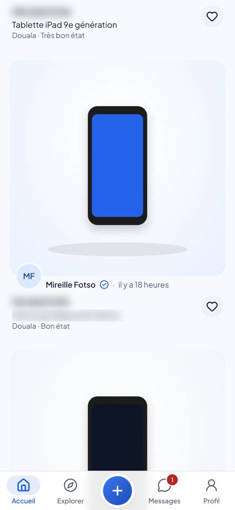

- **Image** : Junior a maintenant le téléphone en main. Page d'accueil réelle : logo, « Rechercher un article… », « Recommandé pour vous », « Annonces récentes » ; défilement doux, puis balayage des photos d'une annonce dans le fil.
- **Caméra** : Enregistrement d'écran plein cadre, dans un téléphone qui flotte légèrement (motion design).
- **Voix off** : « Un endroit où tes affaires peuvent commencer une nouvelle vie. »
- **À l'écran** : Scénario fictif. Annonces, prix et messages de démonstration. (bas d'écran, de 0:31 à 1:05)
- **Son** : Sons d'interface discrets (défilement, toucher).
- **16:9** : Option : version ordinateur du site (barre latérale) pour ce plan.

### 3B · 0:34 – 0:36,5 · Interface réelle — Recherche et catégories

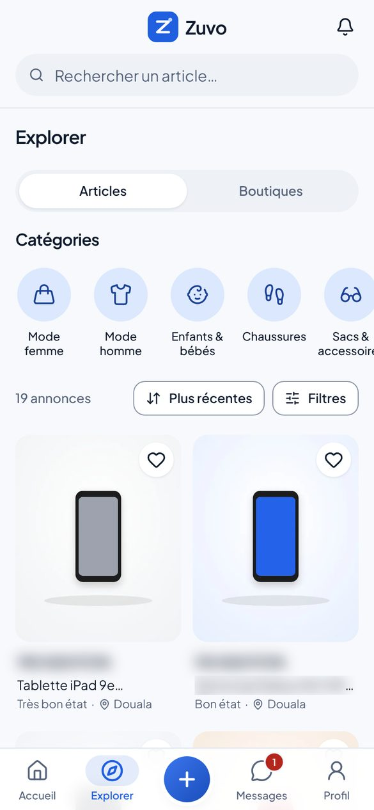 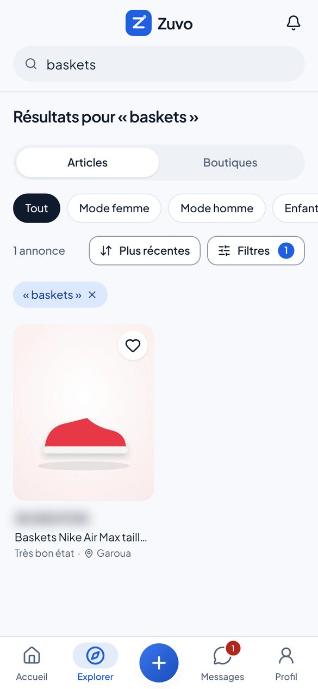

- **Image** : Explorer : onglets Articles / Boutiques, catégories réelles ; saisie de « baskets » dans la recherche, résultats.
- **Caméra** : Enregistrement d'écran ; zoom doux sur la grille des catégories.
- **Son** : Frappe au clavier discrète.
- **16:9** : Écran partagé : catégories à gauche, résultats à droite.

### 3C · 0:36,5 – 0:39 · Interface réelle — Fiche produit

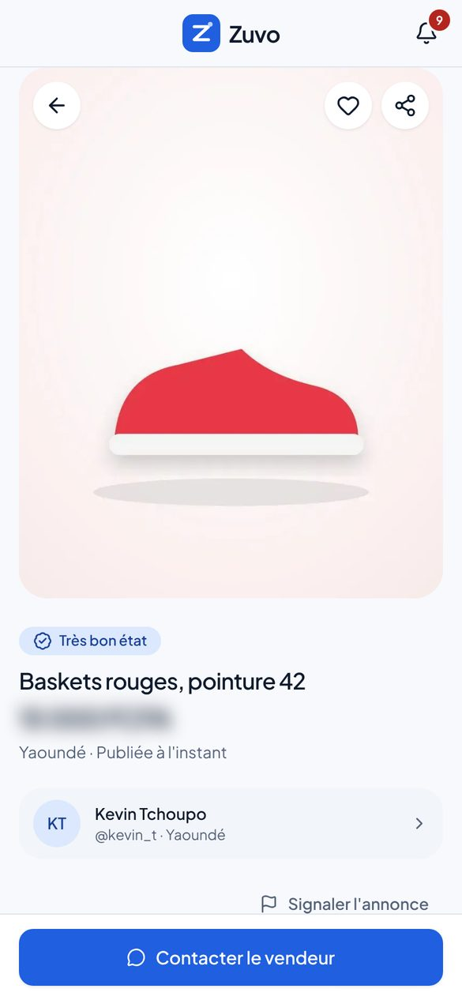

- **Image** : Fiche d'une annonce de démonstration : photo, « Très bon état », titre, prix, ville, « Publiée… », vendeur, bouton « Contacter le vendeur ».
- **Caméra** : Enregistrement d'écran ; léger zoom sur le prix et l'état.
- **À l'écran** : Prix : montant à valider, sinon flouté (comme sur cette planche).
- **16:9** : Téléphone à droite, infos clés reprises en texte à gauche.

### 3D · 0:39 – 0:41 · Plan rapproché — 1. Prends tes photos

- **Image** : Junior pose ses baskets sur le rebord de la fenêtre, en pleine lumière, et les photographie avec son téléphone.
- **Caméra** : Plan rapproché par-dessus l'épaule, puis insert sur l'écran de l'appareil photo.
- **Voix off** : « Tu prends quelques photos, tu ajoutes le prix et les informations de ton article, puis tu publies ton annonce. »
- **À l'écran** : « 1. Prends tes photos »
- **Son** : Déclencheur photo, léger flash blanc.
- **16:9** : Junior à gauche, la fenêtre et les baskets à droite.

### 3E · 0:41 – 0:45,5 · Interface réelle (accéléré lisible) — 2. Publie ton annonce

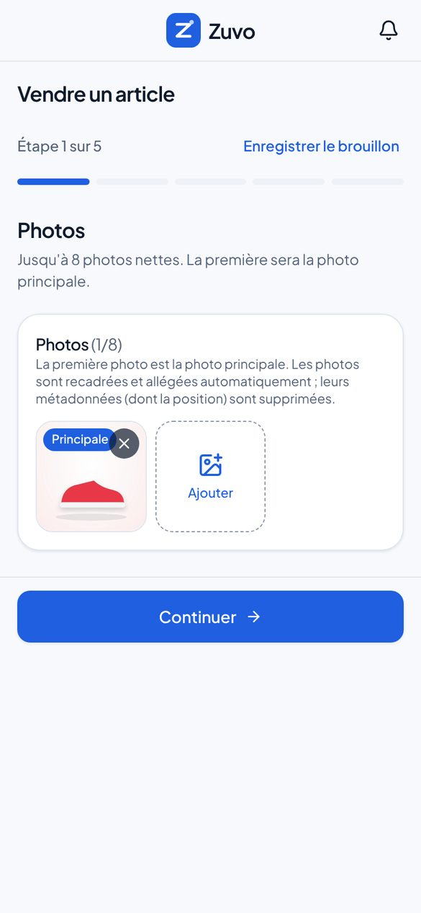 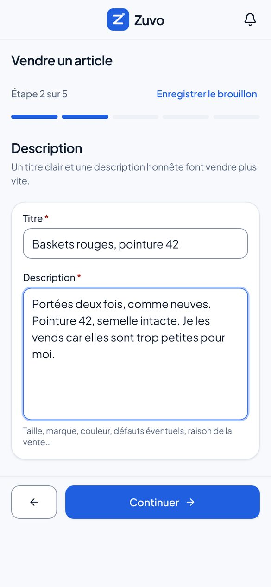 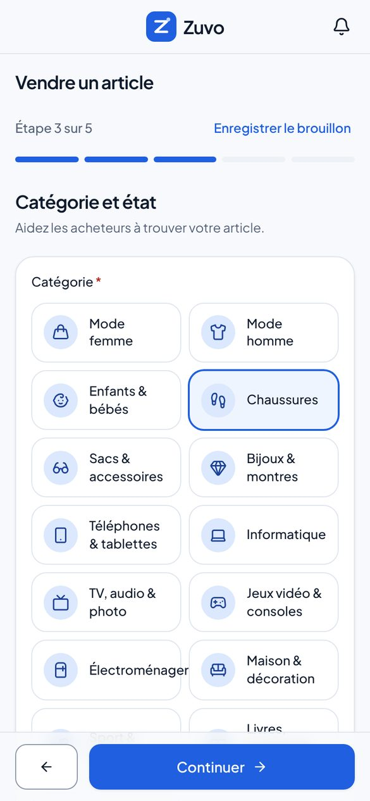 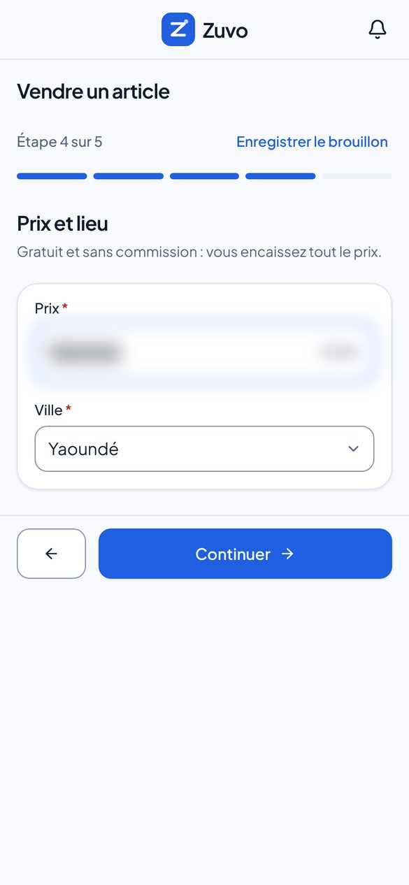 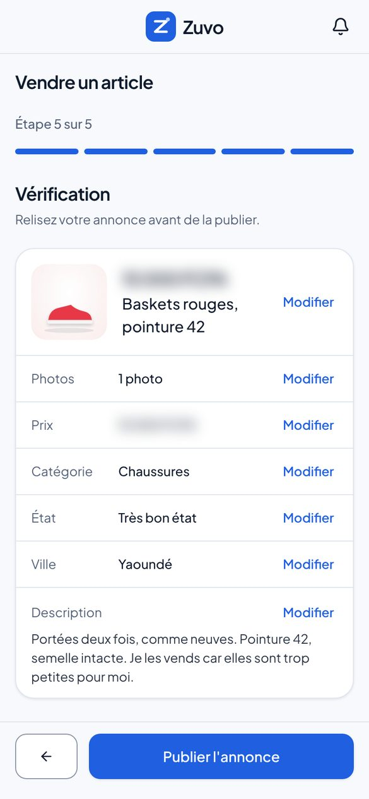

- **Image** : Parcours réel « Vendre un article », environ une seconde par étape : Photos (photo « Principale ») → Description (titre) → Catégorie et état (« Chaussures », « Très bon état ») → Prix et lieu (prix, « Yaoundé ») → Vérification. La barre « Étape x sur 5 » progresse.
- **Caméra** : Enregistrement d'écran ; transitions latérales identiques à celles du site.
- **À l'écran** : « 2. Publie ton annonce »
- **À l'écran** : Puces animées reprenant les vrais champs : Titre · Description · Catégorie · État · Prix · Ville
- **Son** : Un « clic » doux à chaque « Continuer ».
- **16:9** : Les cinq étapes en frise horizontale, l'étape active agrandie.

### 3F · 0:45,5 – 0:47,5 · Insert macro + interface — « Publier l'annonce »

 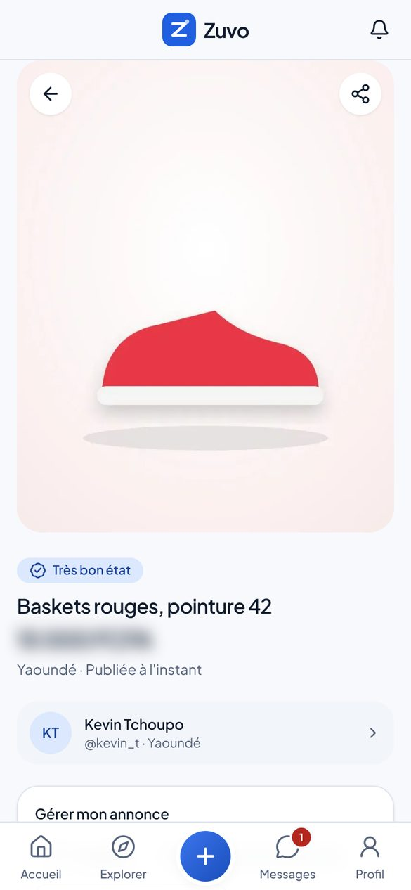

- **Image** : Gros plan du pouce qui touche « Publier l'annonce », puis la page de l'annonce publiée : « Publiée à l'instant », panneau « Gérer mon annonce ».
- **Caméra** : Macro (100 mm) sur le pouce, raccord sur l'enregistrement d'écran.
- **Voix off** : « Les personnes intéressées peuvent découvrir ton article et te contacter. »
- **Son** : Montée musicale puis impact sur le toucher (première montée demandée).
- **16:9** : Identique, téléphone centré.

### 3G · 0:47,5 – 0:51 · Interface réelle — 3. Échange avec les acheteurs

- **Image** : La même annonce vue par un acheteur, avec le bouton « Contacter le vendeur ».
- **Caméra** : Enregistrement d'écran, léger zoom sur le bouton.
- **À l'écran** : « 3. Échange avec les acheteurs »
- **16:9** : Les trois étapes restent affichées à gauche, cochées.

## Scène 4 — Les premiers contacts (0:51 – 1:05)

- **Lieu** : Chambre ; téléphone posé sur le lit.
- **Lumière** : Fin de journée, première lampe allumée.
- **Intention** : L'émotion : quelqu'un s'intéresse à ses affaires. Messages présentés comme une scène reconstituée, sans résultat chiffré.

### 4A · 0:51 – 0:53,5 · Montage elliptique — Il reprend ses activités

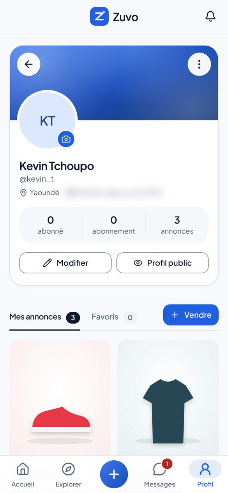

- **Image** : Coupes rapides : Junior photographie aussi l'ancien téléphone et une chemise ; son profil affiche « Mes annonces ». Il pose le téléphone sur le lit et commence à ranger ; Boris grignote des arachides.
- **Caméra** : Jump cuts sur le même axe, plan fixe large.
- **À l'écran** : Écran : profil réel, onglet « Mes annonces ».
- **Son** : Musique en groove régulier.
- **16:9** : Identique.

### 4B · 0:53,5 – 0:56,5 · Gros plan + interface — Le premier message

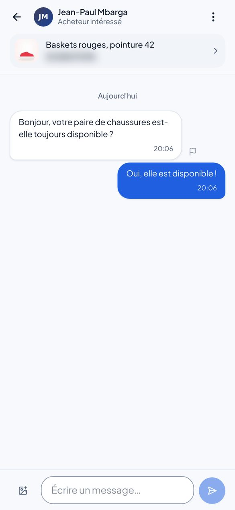

- **Image** : Le téléphone vibre sur le lit. Gros plan : badge rouge sur « Messages ». Junior ouvre la conversation (message lisible au moins 2 secondes).
- **Caméra** : Gros plan du téléphone, puis enregistrement d'écran.
- **À l'écran** : Message (scène reconstituée) : « Bonjour, votre paire de chaussures est-elle toujours disponible ? »
- **Son** : Vibration, petite note musicale. Pas de bannière push par défaut (voir points à valider).
- **16:9** : Téléphone et visage de Junior dans le même cadre.

### 4C · 0:56,5 – 0:58,5 · Plan rapproché + interface — « Oui, elle est disponible ! »

- **Image** : Junior sourit et répond ; la bulle bleue part dans la conversation.
- **Caméra** : Plan rapproché, raccord sur l'écran.
- **Junior** : « Oui, elle est disponible ! »
- **À l'écran** : Réponse affichée dans la conversation.
- **Son** : Son d'envoi discret.
- **16:9** : Écran partagé : visage / conversation.

### 4D · 0:58,5 – 1:00,5 · Interface réelle — Un second acheteur

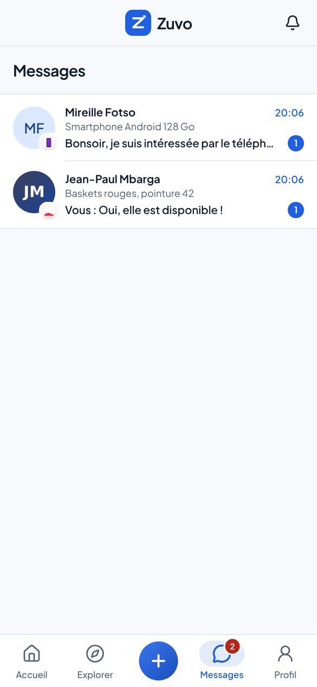

- **Image** : Nouvelle vibration : une deuxième conversation apparaît dans « Messages », pour l'ancien téléphone.
- **Caméra** : Enregistrement d'écran de la boîte de réception.
- **À l'écran** : Message (scène reconstituée) : « Bonsoir, je suis intéressée par le téléphone. »
- **Son** : Vibration, deuxième note (la musique monte).
- **16:9** : Identique.

### 4E · 1:00,5 – 1:05 · Plan à deux — « Je t'avais dit, mon frère ! »

- **Image** : Junior se tourne vers Boris, surpris et amusé. Boris, la bouche pleine, sourit.
- **Caméra** : Plan à deux fixe, réactions naturelles (laisser jouer).
- **Junior** : « Héé, donc mes vieilles affaires avaient encore de la valeur ?! »
- **Boris** : « Je t'avais dit, mon frère ! »
- **Son** : Montée musicale vers la scène 5.
- **16:9** : Identique, la chambre visible autour d'eux.

## Scène 5 — L'esprit de la communauté camerounaise (1:05 – 1:17)

- **Lieu** : Quatre lieux de vie variés (chambre d'étudiante, pause déjeuner sous un auvent, salon, trajet en taxi).
- **Lumière** : Jour, lumières naturelles différentes selon les lieux.
- **Intention** : Élargir : Zuvo s'adresse à des profils variés. Aucun compteur, aucun nom de ville à l'écran (le site est en bêta).

### 5A · 1:05 – 1:08 · Plan rapproché — L'étudiante

- **Image** : Une étudiante (chambre de cité universitaire, style décontracté) photographie un sac à main posé sur son lit ; insert sur l'étape « Photos ».
- **Caméra** : Plan rapproché, caméra épaule.
- **Voix off** : « Que tu sois étudiant, jeune actif ou simplement quelqu'un qui veut faire de la place chez lui, Zuvo te permet de donner une seconde vie à tes affaires et de découvrir de bonnes occasions. »
- **Son** : Montage sur les temps, musique pleine.
- **16:9** : Personnage à gauche, écran à droite.

### 5B · 1:08 – 1:11 · Plan moyen — Le jeune actif

- **Image** : Un jeune actif (chemise, pause déjeuner sous un auvent) consulte des chaussures sur son téléphone dans Explorer.
- **Caméra** : Plan moyen, léger travelling latéral.
- **16:9** : Identique.

### 5C · 1:11 – 1:14 · Plan rapproché — L'appareil électronique

- **Image** : Une femme d'une quarantaine d'années, dans son salon, photographie une enceinte sur une table bien éclairée.
- **Caméra** : Plan rapproché, mise au point sur l'enceinte.
- **16:9** : Identique.

### 5D · 1:14 – 1:17 · Plan rapproché — L'acheteur

- **Image** : Un jeune homme, à l'arrière d'un taxi, découvre une annonce qui l'intéresse et touche le cœur pour l'ajouter à ses favoris ; il sourit.
- **Caméra** : Plan rapproché, lumière qui défile sur son visage.
- **16:9** : Identique.

## Scène 6 — Conclusion et appel à l'action (1:17 – 1:30)

- **Lieu** : Chambre rangée, puis carte finale en motion design.
- **Lumière** : Lumière douce du soir, puis fond blanc cassé et bleu Zuvo.
- **Intention** : Boucler l'histoire (la chambre a changé) et laisser une marque claire : logo, signature, adresse, appel à l'action.

### 6A · 1:17 – 1:20 · Plan large — La chambre rangée

- **Image** : La chaise est libre, l'armoire en ordre, le ventilateur tourne. Junior, allongé sur le lit, consulte Zuvo et sourit.
- **Caméra** : Plan large fixe, même axe que le plan 1B (avant / après).
- **Voix off** : « Alors, avant de laisser tes affaires prendre la poussière, pense à Zuvo. Publie, découvre, échange… et donne une seconde vie à ce que tu n'utilises plus. »
- **Son** : Musique allégée sous la voix.
- **16:9** : Même axe que 1B : l'effet avant / après est encore plus lisible en 16:9.

### 6B · 1:20 – 1:23 · Transition motion design — Le logo au centre

- **Image** : Junior tourne son téléphone vers la caméra, l'écran envahit le cadre ; le logo Zuvo apparaît au centre avec l'animation de marque.
- **Caméra** : Raccord écran, puis animation 2D.
- **À l'écran** : Logo Zuvo.
- **Son** : Impact doux + scintillement sur la pastille du logo.
- **16:9** : Identique.

### 6C · 1:23 – 1:30 · Carte finale — Appel à l'action

- **Image** : Carte finale sur blanc cassé : ZUVO, « La seconde vie de tes affaires. », « Le marché de la seconde main pensé pour le Cameroun. », adresse du site, « Découvre Zuvo dès maintenant. ».
- **Caméra** : Animation 2D, textes qui entrent l'un après l'autre.
- **À l'écran** : ZUVO
- **À l'écran** : « La seconde vie de tes affaires. »
- **À l'écran** : « Le marché de la seconde main pensé pour le Cameroun. »
- **À l'écran** : [URL OFFICIELLE DE ZUVO À INSÉRER]
- **À l'écran** : « Découvre Zuvo dès maintenant. »
- **Son** : Accord final, la musique se résout ; dernière seconde silencieuse.
- **16:9** : Mise en page horizontale (voir images de référence).

## Bande voix minutée

| Temps           | Qui      | Texte                                                                                                                                                                                       | mots/s |
| --------------- | -------- | ------------------------------------------------------------------------------------------------------------------------------------------------------------------------------------------- | ------ |
| 0:03 – 0:07,4   | Junior   | Même ma chambre est devenue un magasin maintenant… Tout ça, je n'utilise même plus !                                                                                                        | 3.2    |
| 0:07,6 – 0:12,3 | Voix off | On a tous des affaires qu'on n'utilise plus. Des vêtements, des chaussures, des téléphones, des accessoires…                                                                                | 3.4    |
| 0:12,6 – 0:16,8 | Voix off | Pourtant, ce qui dort chez toi peut encore faire le bonheur de quelqu'un d'autre.                                                                                                           | 3.3    |
| 0:17,1 – 0:18   | Boris    | Ko ko ko !                                                                                                                                                                                  | 3.3    |
| 0:19,1 – 0:21   | Boris    | Tu comptes garder tout ça jusqu'à quand ?                                                                                                                                                   | 3.7    |
| 0:21,3 – 0:23,4 | Junior   | Je ne sais même plus quoi en faire !                                                                                                                                                        | 3.8    |
| 0:23,7 – 0:28,9 | Boris    | Mon frère, tu connais Zuvo ? Tu peux publier tes articles et trouver des gens qui veulent les acheter.                                                                                      | 3.5    |
| 0:29,4 – 0:31,9 | Voix off | Voici Zuvo, la marketplace pensée pour le Cameroun.                                                                                                                                         | 3.2    |
| 0:32,2 – 0:35,4 | Voix off | Un endroit où tes affaires peuvent commencer une nouvelle vie.                                                                                                                              | 3.1    |
| 0:39,2 – 0:45,6 | Voix off | Tu prends quelques photos, tu ajoutes le prix et les informations de ton article, puis tu publies ton annonce.                                                                              | 3.0    |
| 0:46,8 – 0:50,8 | Voix off | Les personnes intéressées peuvent découvrir ton article et te contacter.                                                                                                                    | 2.5    |
| 0:56,8 – 0:58,3 | Junior   | Oui, elle est disponible !                                                                                                                                                                  | 2.7    |
| 1:00,8 – 1:03,4 | Junior   | Héé, donc mes vieilles affaires avaient encore de la valeur ?!                                                                                                                              | 3.8    |
| 1:03,6 – 1:04,9 | Boris    | Je t'avais dit, mon frère !                                                                                                                                                                 | 3.8    |
| 1:05,3 – 1:16,8 | Voix off | Que tu sois étudiant, jeune actif ou simplement quelqu'un qui veut faire de la place chez lui, Zuvo te permet de donner une seconde vie à tes affaires et de découvrir de bonnes occasions. | 3.0    |
| 1:17,3 – 1:27   | Voix off | Alors, avant de laisser tes affaires prendre la poussière, pense à Zuvo. Publie, découvre, échange… et donne une seconde vie à ce que tu n'utilises plus.                                   | 2.7    |

Voix off : interprétation humaine, chaleureuse et expressive, français parlé au Cameroun, sans accent
forcé ni ton institutionnel. Si l'interprétation est plus lente, la scène 1 s'allonge au détriment des
plans muets de la scène 5.

## Musique et son

Afro-fusion / amapiano instrumental (≈ 110 BPM), **sous licence couvrant la publicité payante** sur
TikTok, Instagram, Facebook et WhatsApp (ou composition sur commande avec cession de droits).

| Temps       | Musique                                                                 |
| ----------- | ----------------------------------------------------------------------- |
| 0:00 – 0:17 | Intro légère (shaker, guitare), ambiance du quartier, ventilateur       |
| 0:17 – 0:31 | Entrée du groove ; pause sur « tu connais Zuvo ? » ; impact sur le logo |
| 0:31 – 0:45 | Groove régulier, sons d'interface discrets                              |
| 0:45 – 0:47 | Montée puis impact sur « Publier l'annonce »                            |
| 0:47 – 1:05 | Groove plein, une note à chaque message, seconde montée                 |
| 1:05 – 1:17 | Pleine énergie, montage sur les temps                                   |
| 1:17 – 1:30 | Arrangement allégé sous la voix, accord final sur la carte              |

## Adaptation 16:9

- Plans tournés en 16:9 et cadrés pour le 9:16 : le 16:9 montre davantage la chambre (effet avant / après
  1B → 6A plus lisible).
- Démo (scène 3) : écran partagé, tournage à gauche, téléphone avec l'interface réelle à droite, étapes
  1-2-3 en colonne ; option : version ordinateur du site (barre latérale) pour l'accueil et Explorer.
- Carte finale en mise en page horizontale (voir `images-de-reference/`).

## Points à valider

1. **Minutage** de 90 s (scènes décalées par rapport au brief pour que les répliques tiennent).
1. **Adresse officielle** du site pour la carte finale (l'adresse actuelle est une adresse de bêta).
1. **Prix** des annonces de démonstration : montants validés, ou floutés.
1. **« Gratuit et sans commission »**, affiché par le site à l'étape « Prix et lieu » : le montrer ou recadrer.
1. **Notification push** du téléphone : seulement après tests validés sur Android et iPhone ; sinon badge « Messages ».
1. **Second message** : « Bonsoir, je suis intéressée par le téléphone. »
1. **Prénoms** Junior et Boris (le compte de démonstration portera le nom choisi).
1. **Titre-question** en surimpression pendant les 3 premières secondes.
1. **Mode de production** : A. tournage réel (recommandé), B. génération vidéo par IA, C. animatique seule.

## Modes de production

- **A. Tournage réel (recommandé)** — deux comédiens camerounais et quatre profils en scène 5, un jour et
  demi de tournage. Écrans incrustés en post-production depuis les vrais enregistrements ; voix off par un
  comédien ou une comédienne camerounais(e) ; musique sous licence.
- **B. Génération vidéo par IA** — prompts par plan et fiches personnages. Risques : cohérence des visages
  et des décors d'un plan à l'autre, mains et téléphones. Interfaces incrustées depuis les vraies captures,
  voix off humaine, mention « contenu généré par IA » selon les règles de chaque plateforme.
- **C. Animatique** (réalisable dans cet environnement) — version minutée avec ces cadres, les vrais
  enregistrements d'écran, le motion design, les sous-titres et une musique temporaire. Prévisualisation et
  base de montage, pas le film final.
